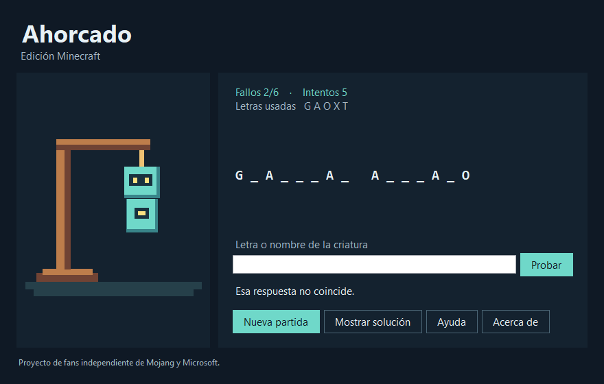

# Ahorcado · Edición Minecraft

Proyecto final de un curso de C# de [davidmotog](https://github.com/davidmotog). Adivina el nombre de una criatura de Minecraft antes de cometer seis fallos. Juego de escritorio para Windows, en español, hecho con Windows Forms y .NET 10.

**[Descargar Ahorcado.exe para Windows x64](https://github.com/davidmotog/Minecraft-Ahorcado-Edition-/releases/latest/download/Ahorcado.exe)** · [Descargar en ZIP](https://github.com/davidmotog/Minecraft-Ahorcado-Edition-/releases/latest/download/Ahorcado-win-x64.zip)

Proyecto de fans independiente de Mojang y Microsoft. [Directrices de uso de Minecraft](https://www.minecraft.net/es-es/usage-guidelines)



## Cómo jugar

1. Abre **Ahorcado.exe**. Si descargaste el ZIP, descomprímelo primero. El ejecutable incluye el entorno de ejecución de .NET.
2. Pulsa **Comenzar** y prueba una letra o escribe el nombre completo. Puedes pulsar **Intro** para enviar la respuesta.
3. Hay seis fallos por partida. Las respuestas repetidas y las entradas inválidas se ignoran. Se admiten mayúsculas, minúsculas y respuestas sin tildes. La Ñ cuenta como letra distinta de la N.
4. Pulsa **Mostrar solución** si quieres ver la respuesta, o **Nueva partida** para intentarlo con otra criatura.

## Código y compilación

Abre [Ahorcado.sln](Ahorcado.sln) en una versión de Visual Studio compatible con .NET 10, o ejecuta estos comandos en Windows con el [SDK de .NET 10](https://dotnet.microsoft.com/download/dotnet/10.0).

```powershell
dotnet build Ahorcado.sln -c Release
dotnet run --project src/Ahorcado
dotnet run --project tests/Ahorcado.Pruebas -c Release
```

El proyecto de juego está en [src/Ahorcado](src/Ahorcado). `Partida.cs` contiene las reglas, `Criaturas.cs` el vocabulario y `VentanaJuego.cs` la interfaz. Las pruebas comprueban los nombres compuestos, las tildes, la Ñ, los intentos repetidos y el final de partida. El dibujo por bloques se genera en el propio juego.

[GitHub Actions](https://github.com/davidmotog/Minecraft-Ahorcado-Edition-/actions/workflows/windows.yml) compila el juego, ejecuta las pruebas y guarda la edición portátil. Cada publicación incluye `SHA256SUMS-EXE.txt` para comprobar el ejecutable y `SHA256SUMS.txt` para comprobar el ZIP.

## Licencia

El código y el dibujo de esta edición se distribuyen con la [licencia MIT](LICENSE). Minecraft y sus marcas pertenecen a sus respectivos titulares.
